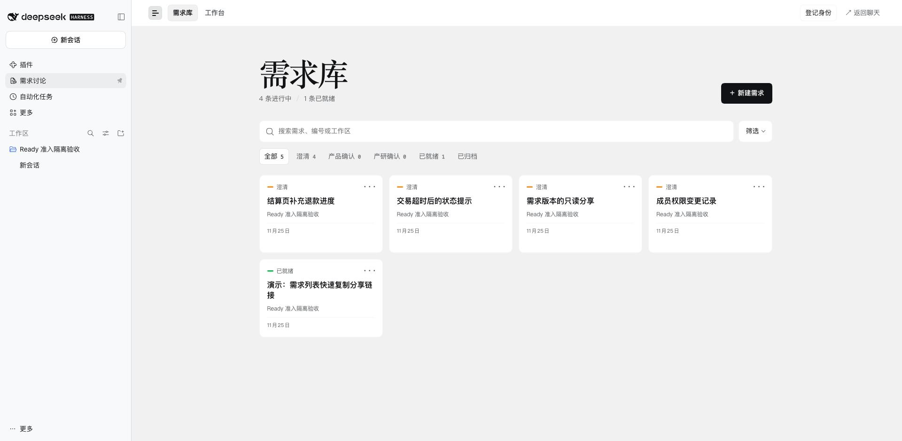
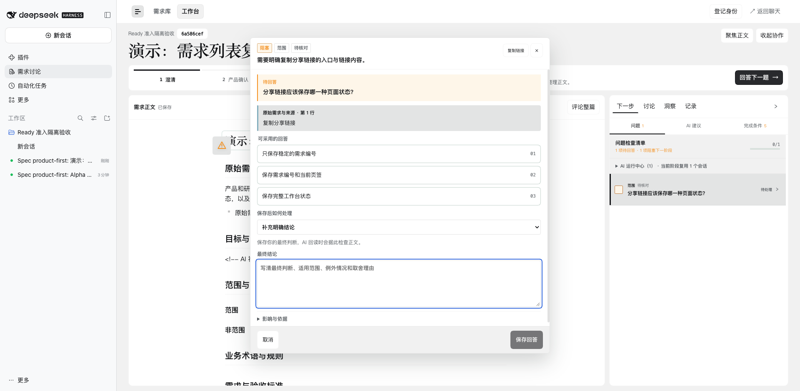
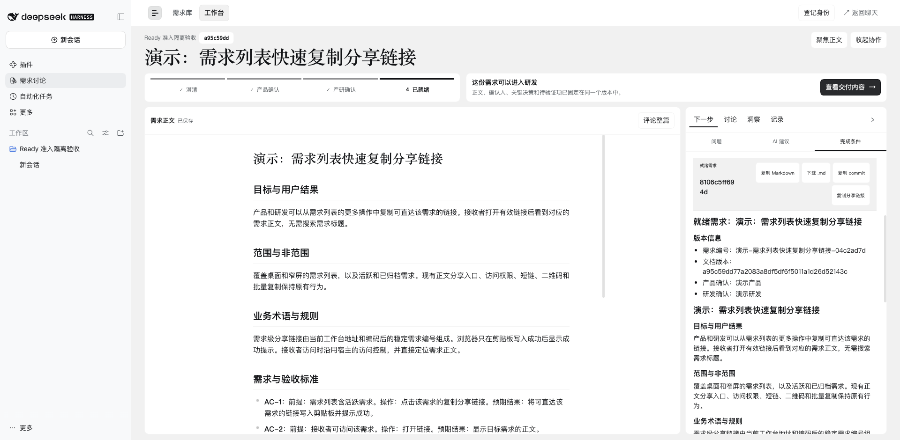

# dsh-spec-collab

[](https://www.npmjs.com/package/dsh-spec-collab)
[](LICENSE)

**把模糊需求变成产品、研发和开发 AI 都能直接使用的 Ready Spec。**

这是一个 DeepSeek Harness 插件。AI 结合项目上下文找出需求缺口，人回答问题、审阅修改，产品和研发对同一版正文确认后导出 Markdown。每次正式修改都有 Git 版本，团队可以追溯当时确认了什么。

## 单 HTML 互动演示

[在测试游记打开演示](https://www.zhongxin.website/tools/spec-collab/) · [下载单 HTML](https://github.com/zx490336534/dsh-spec-collab/releases/download/v0.6.2/spec-collab.html)

打开即可用虚构报表需求体验审核候选改动、双方确认、改版后旧确认失效和 Ready Spec Markdown 下载。审核使用预设结果，确认在当前页面模拟，刷新时重置。下载后可离线打开。

在源码目录执行 `pnpm install --frozen-lockfile` 和 `pnpm build:html`，产物为 `dist/spec-collab.html`。静态站点可把该文件作为 `index.html` 部署。构建后运行 `pnpm test:html` 可用本机 Chrome 验证离线流程。

## Codex 版本

[Spec Collab for Codex](https://github.com/zx490336534/dsh-spec-collab/tree/main/codex-plugin#readme) 可直接从本仓库的 Marketplace 安装。它复用同一套 Git 版本、审核流程和 Ready 准入规则，在本地浏览器工作台完成产研共审。

## 从想法到交付

### 1. 录入需求，选定项目

从 DSH 左侧打开「需求讨论」，写下用户问题和期望结果，选择对应工作区。AI 自动发起初审。多条需求可以在需求库里按关键词、工作区和阶段查找。



### 2. 回答问题，审阅 AI 修改

在正文旁查看 AI 提出的缺口与依据，逐项回答。AI 根据回复生成候选修改，由人检查差异并决定是否写入 Git。评论、关键决策和版本历史都可以回到对应的需求查看。



### 3. 双方确认，导出 Ready Spec

当前版本通过研发预审和内容检查后，产品与研发分别确认同一个 commit，再生成 Ready Spec。导出的 Markdown 包含正文、验收标准、关键决策、参考资料和确认人。正文改版后需要重新确认。插件的工作到 Ready Spec 为止。



## 安装

**桌面版** · 在 DSH「插件」中添加 `dsh-spec-collab@0.6.1`，然后打开侧栏的「需求讨论」。

**独立 Web** · 使用与宿主同版本的 CLI 安装到正在使用的 profile。下面以 `0.2.2-rc.5` 为例。

```sh
npx -y @deepseek-ai/dsh@0.2.2-rc.5 plugin --profile web add dsh-spec-collab@0.6.1
```

宿主需安装 Git，并为 AI 审核配置可用模型。插件支持 DSH `0.2.1-rc.5` 起的 `0.2.1` 系列、`0.2.2-rc.1` 起的 `0.2.2` 系列，以及 `0.2.3-alpha.2`。

[使用说明](docs/usage-walkthrough.md) · [配置与部署](docs/configuration.md) · [数据迁移](docs/migration-v3.md) · [更新记录](CHANGELOG.md)
