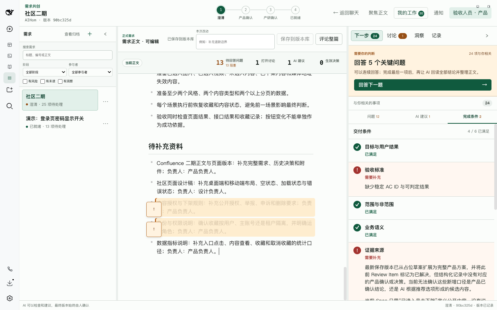
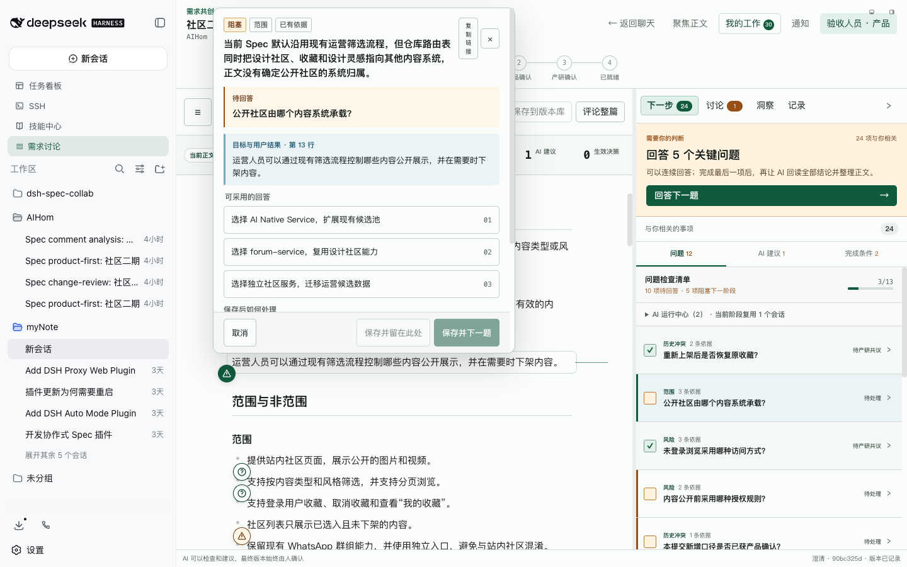
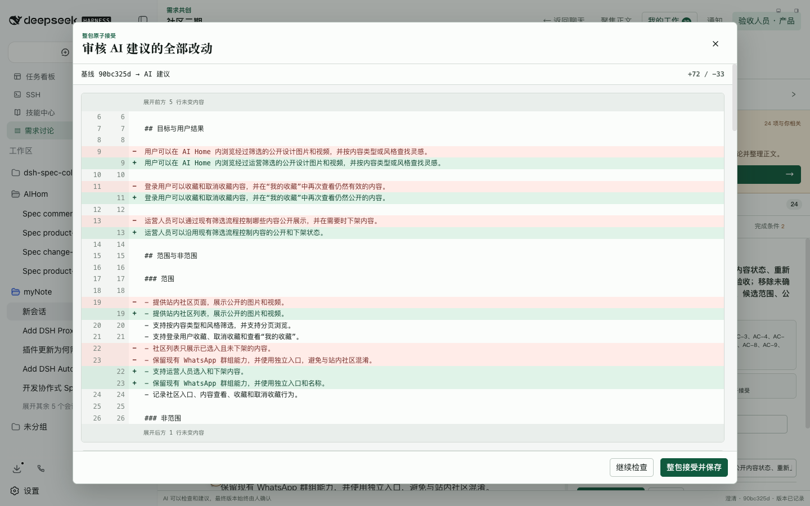
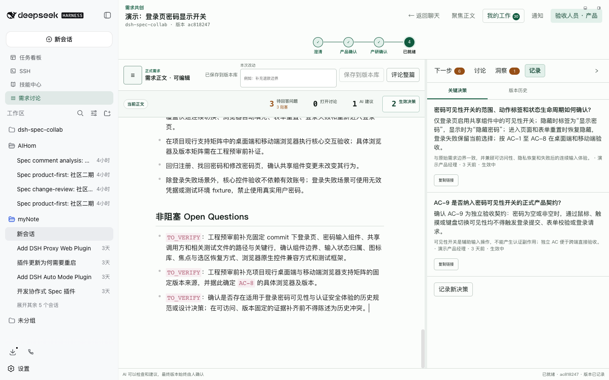
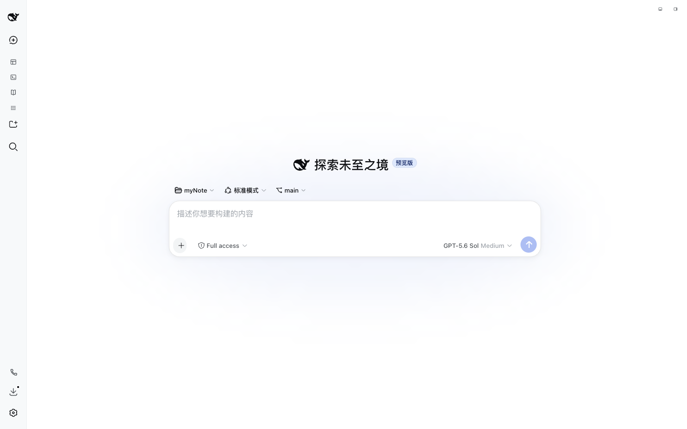

# dsh-spec-collab

[](https://www.npmjs.com/package/dsh-spec-collab)
[](LICENSE)

DeepSeek Harness 的需求“编辑校样台”，用于把原始需求澄清为研发和开发 AI 可直接理解的 Ready Spec。需求文档是主画布，评论、客户洞察、决策、版本差异和 AI 建议通过批注边栏与全屏抽屉完成闭环。

产品边界严格止于 Ready Spec，不包含代码实现、测试用例生成、worktree、MR、部署、发布或交付状态管理。

当前版本为 `v0.3.1`，兼容 DeepSeek Harness `v0.1.1-rc.1`。插件可在局域网 HTTP 地址下运行，不依赖浏览器提供 `crypto.randomUUID`；DSH 精简侧栏仅显示“设置”时，也会正常挂载“需求讨论”入口。

## 一键安装

已有 Node.js 环境时，无需先全局安装 DSH CLI：

```sh
npx -y @deepseek-ai/dsh@0.1.1-rc.1 plugin --profile web add dsh-spec-collab@latest
```

如果 `dsh` 已在 `PATH` 中，也可以使用简写：

```sh
dsh plugin --profile web add dsh-spec-collab@latest
```

安装后重启现有的 `dsh web` 进程。后续更新使用：

```sh
dsh plugin --profile web update dsh-spec-collab@latest
```

插件已经内置非安全 HTTP 环境所需的 UUID fallback，不需要通过代理向 HTML 注入 `crypto` polyfill。团队部署仍建议使用 HTTPS，并在 DSH 前配置认证。

## 核心流程

```text
输入原始需求
  -> 产品 AI 自动初审（九个维度）
  -> 产品逐项回应
  -> 产品 AI 二次审核 + 候选 patch
  -> 产品确认当前 commit
  -> 产研 + 双方 AI 共审
  -> 产品/研发分别确认当前 commit
  -> 六项 Ready 门
  -> 输出 Ready Spec
```

每个需求固定绑定一个 DSH 工作区和一条 Git 版本链。AI 的审核、评论分析和候选 Patch 都基于明确 commit；产品与研发的确认也绑定 commit。正文变化后，受影响的确认和候选 Patch 会失效，避免拿旧结论证明新版本已经就绪。

## 工作台结构

当前工作台以需求正文为主画布，不再把流程拆成多个相互割裂的页面：

- 顶部显示需求标题、绑定工作区、当前 commit 和“澄清 / 产品确认 / 产研确认 / 已就绪”四阶段进度。
- 左侧需求栏提供搜索、阶段/参与者/风险筛选、新建、归档、恢复和删除；收起后正文获得更大空间。
- 中间正文支持 Markdown 编辑、显式保存、整篇评论、行内批注、原文定位和评论定位；正文上方汇总待回答问题、打开讨论、AI 建议和生效 Decision。
- 右侧协作栏分为“下一步 / 讨论 / 洞察 / 记录”。“下一步”按当前参与者聚合待办，“记录”集中展示 Decision 与版本历史。
- “我的工作”和通知跨需求汇总与本人相关的回复、确认、提及、指派及状态变化；服务端通过 SSE 推送变化，多浏览器刷新后仍可继续。
- 桌面宽屏使用正文与协作栏并排布局；窄屏切换为“需求列表 / 需求正文 / 协作”，并保留键盘导航和正文专注模式。

## 角色与责任

| 参与者 | 可以做什么 | 不能代替谁 |
| --- | --- | --- |
| 产品 | 创建需求、补充来源、回复问题、编辑正文、接受 Patch、记录 Decision、确认产品语义 | 不能代替研发确认技术理解 |
| 研发 | 评论实现影响、补充技术证据、参与 Decision、确认研发理解 | 不能代替产品决定业务语义 |
| 产品 AI / 研发 AI | 读取绑定工作区及授权资料、提交结构化问题、分析评论、提出候选 Patch | 不能直接写 Git、确认 commit 或标记 Ready |
| 匿名访问者 | 查看需求和协作记录 | 首次评论、修改、回复或确认前必须登记花名与责任角色 |

## 完整演示

下面的图片来自一条全新需求从创建到 Ready Spec 的真实流程，均使用 ego-browser 截取，并在截图前收起 DSH 主侧边栏。

**[阅读完整图文教程](docs/usage-walkthrough.md)**

<details>
<summary>查看完整流程截图</summary>

### 1. 新建需求并选择工作区



### 2. AI 问题清单与人工回复



### 3. 审核候选 Patch



### 4. 查看生效 Decision



### 5. 查看并导出 Ready Spec



</details>

## 当前能力（v0.3.1）

### 需求正文与版本

- 匿名只读；首次评论、修改、回复、确认前登记 `participant_id + 花名 + 责任角色`。
- 原始需求、Markdown PRD、相关链接与代码范围分别记录为来源，不静默混成事实。
- 正式正文只存在 `requirements/<id>/spec.md`，每次显式保存生成一个 Git commit。
- 保存携带 `baseCommit`；过期或存在外部未提交修改时拒绝覆盖。
- 本地草稿存入 IndexedDB，异常关闭后可恢复；正式保存仍由 Git commit 承载。
- 版本历史与 AI Patch 共用结构化行级 diff，未变上下文可折叠；恢复历史会创建新 commit。
- 需求支持搜索、筛选、归档、恢复和删除；删除同时移除对应正式 Spec 与关联洞察关系。

### AI 审核与候选修改

- `FACT / INFERENCE / ASSUMPTION / TO_VERIFY` 结构化 Review Item；`FACT` 强制可访问且带版本的证据。
- 同一需求在同一流程阶段复用一个 DSH AI session；审核、评论分析和追问只追加增量提示，进入下一阶段后再创建新会话。
- 每条实质评论提交后自动进入当前阶段 AI 会话，回复必须包含理解、证据或 `TO_VERIFY`、影响章节/AC 和建议处置。
- AI 只能提交 Review Item、评论分析和候选 patch；不能写 Git、代替人确认或标记 Ready。
- 保存和 patch 接受后自动触发 change review；候选 patch 基于精确 commit，过期自动失效。

### 协作、Decision 与洞察

- Decision、Comment、Confirmation 分离；确认绑定 commit，可按 section/AC 局部失效。
- 评论支持页面级和行内批注、回复、提及、指派、筛选、解决、重开和深链；正文定位与评论定位使用同一套交互。
- “我的工作”按待回复、待确认、由我发起等类别跨需求聚合；通知覆盖提及、回复和状态变化。
- 客户、公司、来源和洞察为独立实体；洞察可关联多个需求、章节或 AC，支持 CSV/Markdown 原子导入和去重。
- v3 协作账本持久化协作、通知、洞察、统一指标和 AI 阶段会话，并通过 SSE 刷新客户端状态。

### Ready 质量门与交付

- Ready 门检查目标与用户结果、稳定 AC、范围与非范围、业务语义、证据来源、测试约束。
- 生成 Ready 必须处于产研共审、已绑定工作区，当前 commit 至少有一次已完成的 `engineering-precheck`，且没有当前版本正在排队/运行的审核或待处理候选 Patch。缺失、失败、运行中或旧 commit 的研发预审都不能替代当前版本已完成的预审。
- 产品与研发必须分别对同一个当前 commit 做有效的整版确认；章节、AC 或 Decision 确认不能替代。正文改版后重新完成当前版本研发预审和双方整版确认。产品二审仍是进入产品确认阶段的准入条件。
- 前端引导和服务端生成共用 `src/ready-admission.ts`。服务端从 Git 正文重新计算六项内容检查，不信任客户端传入的检查结果。审核完成表示结构化结果已被接受，六项通过主要证明结构与记录满足校验；AI 实际读取、来源原文是否支持陈述及业务语义质量需要工具轨迹与人工复核。
- Ready 输出包含 commit SHA、稳定 AC、Decision、来源、非阻塞 Open Questions 和产品/研发确认人。
- Ready Spec 可直接复制 Markdown、下载 `.md`、复制 commit 或复制分享链接。
- Agent 工具：`spec_list`、`spec_read`、`spec_reply`、`spec_submit_review`、`spec_propose_patch`。

### 工作区上下文

- 新建需求必须选择一个 DSH 工作区；所有 AI 审核和评论分析 session 固定挂载该工作区，不会落入未分组 session。
- 支持默认 AI 上下文与工作区专属上下文合并，统一声明 Skill、MCP server、本地参考文档和 Agent Preset。

## AI 上下文配置

插件通过 DSH profile 的 `cordis.patch.yml` 接收配置。`defaultContext` 会应用到全部工作区；`workspaces` 只为指定 `workspaceId` 追加资源，并可覆盖默认 `agentPreset`。未列入 `workspaces` 的已登记工作区仍可创建需求并继承默认上下文。

```yaml
- id: spec-collab
  config:
    defaultContext:
      skills:
        - requirements-review
      mcpServers:
        - confluence
      documentPaths:
        - ~/company-docs/product-rules.md
      agentPreset: spec-review
    workspaces:
      - workspaceId: 00000000-0000-4000-8000-000000000001
        skills:
          - payment-domain
        mcpServers:
          - payments
        documentPaths:
          - docs/payment-rules.md
        agentPreset: spec-review-payments
```

新建需求窗口会读取 DSH 当前登记的全部工作区并要求选择。工作区专属 `documentPaths` 可写相对路径，AI 会基于所选工作区根目录读取；共享文档建议使用绝对路径或 `~`。页面接口 `GET /api/spec-collab/review-workspaces` 返回可选工作区的 `workspaceId`、标题和路径，可用于填写覆盖配置。

升级前创建、尚未保存 `workspaceId` 的需求会显示“未绑定工作区”，其 AI 审核按钮保持禁用；通过“绑定工作区”补齐一次后即可继续。已绑定需求不允许切换工作区，避免同一需求的审核上下文中途变化。

Skill 和 MCP 必须已经由对应 Agent Preset 挂载：Skill 名称会要求 AI 先通过 `skill` 工具加载，MCP serverName 会映射为 `mcp__<serverName>__*` 工具 namespace。本插件不会在单次审核中安装外部代码或启动未授权 MCP；资源不可用时，AI 必须明确标记 `TO_VERIFY`，不能伪造 `FACT`。

绑定工作区会把 AI session 的当前目录设为该工作区的真实路径，但“挂载成功”不代表模型已经读取项目文件。默认工作区提示词会强制每次审核先检查根目录，读取存在的 `AGENTS.md`、`CONTEXT.md`、`README.md`、`CONTRIBUTING.md` 和项目清单，再按需求定位相关代码、文档、测试及 Git 历史。业务专属资料仍建议通过 `documentPaths` 明确指定。

## AI 提示词配置

`prompts` 中每个字段都可以单独覆盖，未填写的字段继续使用插件当前内置提示词。动态的需求 ID、commit、审核类型和 session ID 由插件注入，不需要写进自定义提示词。

```yaml
- id: spec-collab
  config:
    prompts:
      common: |-
        所有输出使用简体中文，并遵守团队的需求审核规范。
      productFirst: |-
        先检查用户目标、范围、业务规则和验收标准，再提交结构化审核结果。
      workspaceContext: |-
        ## 项目上下文
        项目：{{WORKSPACE_TITLE}}
        根目录：{{WORKSPACE_PATH}}
        审核前先读取项目规则、说明文档和相关实现。
        {{WORKSPACE_SNAPSHOT}}
        {{RESOURCE_INSTRUCTIONS}}
      resourceInstructions: |-
        可用 Skill：{{SKILLS}}
        可用 MCP：{{MCP_SERVERS}}
        指定文档：{{DOCUMENT_PATHS}}
      followUp: |-
        请基于当前审核上下文回答下面的追问：

        {{CONTENT}}
```

可配置字段：`system`、`workspaceContext`、`resourceInstructions`、`common`、`productFirst`、`productSecond`、`engineeringPrecheck`、`changeReview`、`comment`、`followUp`。

`workspaceContext` 必须各保留一次 `{{WORKSPACE_SNAPSHOT}}` 和 `{{RESOURCE_INSTRUCTIONS}}`，还支持 `{{WORKSPACE_ID}}`、`{{WORKSPACE_TITLE}}`、`{{WORKSPACE_PATH}}`。`resourceInstructions` 支持 `{{RESOURCE_DETAILS}}`、`{{SKILLS}}`、`{{MCP_SERVERS}}`、`{{DOCUMENT_PATHS}}`。`followUp` 必须保留且只能保留一个 `{{CONTENT}}`。未知变量和缺失的必需变量会在插件启动时直接报错，避免错误模板进入 AI 会话。完整默认值由包入口导出的 `DEFAULT_REVIEW_PROMPTS` 提供。

## 从源码安装（开发）

需要 Node.js 20+、pnpm 9+ 和可用的 DeepSeek Harness。

```sh
git clone https://github.com/zx490336534/dsh-spec-collab.git
cd dsh-spec-collab
pnpm install
pnpm run typecheck
pnpm test
pnpm run build
dsh plugin --profile web add "link:$(pwd)"
```

首次安装或 Host 代码变更后重启现有 `dsh web`。Client 开发时需在 DeepSeek Harness checkout 运行 `pnpm run dev:web`，插件侧运行 `pnpm run bundle --watch`，现有 GUI 的 client-plugin HMR 才会接收 bundle 更新。

## 键盘与响应式工作台

- `Cmd/Ctrl+S`：保存到版本库；缺少改动说明时会解释禁用原因。
- `Cmd/Ctrl+Shift+F`：进入或退出正文专注模式。
- 页签支持左右方向键与 `Home/End`；分栏支持方向键调宽，按住 `Shift` 加速。
- ≥1280px 使用三栏；960～1279px 收起需求导航；小于 960px 使用“需求列表 / 需求正文 / 协作”分段切换。

## 客户洞察导入

CSV 必填 `body`，可选 `title`、`customer`、`company`、`external_ref`、`source`、`importance`、`captured_at` 和 `targets`。Markdown 的每个二级标题对应一条洞察。单文件最大 5 MB、最多 2,000 条，提交前会展示新增、更新、重复和逐行错误，服务端以单个幂等动作原子提交。

[下载 CSV 模板](docs/insight-import-template.csv) · [查看 Markdown 模板](docs/insight-import-template.md)

## 数据与迁移

```text
~/.dsh/spec-collab/
  collaboration-v2.json       # 保留的 v0.2.x 原始数据，供回滚读取
  collaboration-v2.backup-<timestamp>.json
  collaboration-v3.json       # 协作、通知、洞察、统一指标和 AI 阶段会话
  repository/.git/            # 正式版本历史
  repository/requirements/
    <requirement-id>/spec.md
```

Git 是正式 Spec 版本的唯一事实源；协作账本不保存第二套 Markdown 历史。未正式保存的草稿只保存在当前浏览器 IndexedDB。

[阅读 v3 迁移、回滚与隐私说明](docs/migration-v3.md)

## 安全与限制

- 默认仅允许 loopback + same-origin 浏览器请求。通过域名开放给团队前，需要在 DSH 前配置真实认证和可信反向代理策略。
- 花名用于协作归因，不是强身份认证；当前版本不提供 OAuth、组织、细粒度 ACL。
- 客户记录只保存显示名、公司名和外部编号，不保存邮箱、电话、凭证；重要度分不阻断 Ready。
- Markdown 禁用原始 HTML；正文最大 2 MB。
- AI review session 使用 DSH 既有 preset/sandbox 权限，不发送权限升级命令。
- 当前版本不实现 CRDT/OT、实时光标、附件上传和三方合并编辑器；并发保存使用 commit 冲突阻断。
