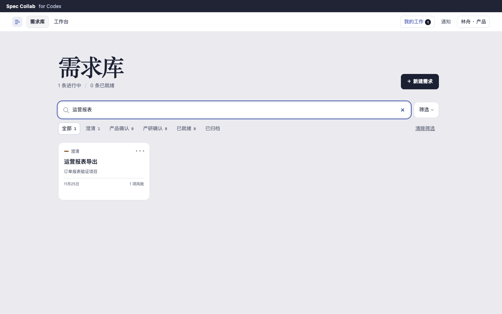
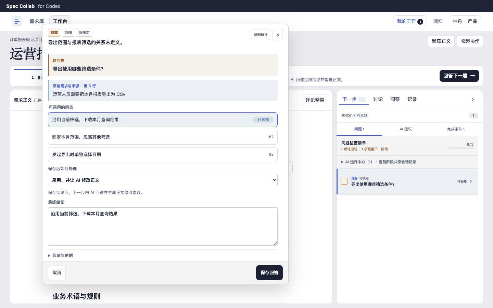
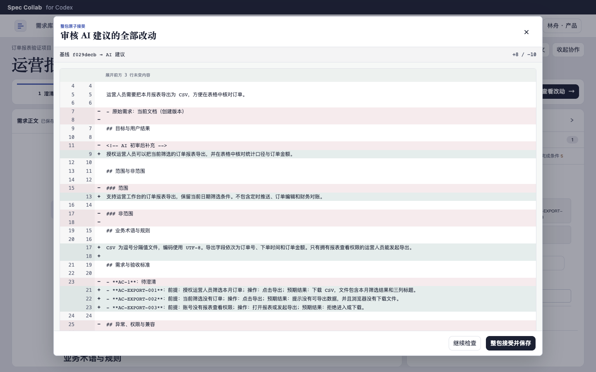
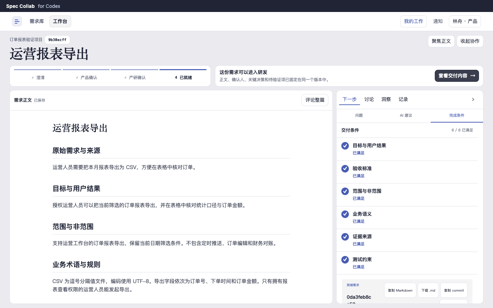

# Spec Collab for Codex

在 Codex 中打开需求工作台，把原始需求整理成可以交付研发的 **Ready Spec**。Codex 读取所选项目的代码和资料，提出结构化问题和候选修改。产品与研发检查同一个 Git 版本，分别确认后导出 Markdown。

## 安装

需要本机 Codex CLI、Node.js 22+、Git 和现代浏览器。本版在 macOS、Codex CLI 0.171.0、Node.js 24 和 Chrome 上验收。用 `codex login status` 检查本机 Codex 登录，后台审核使用这份登录。

```sh
codex plugin marketplace add zx490336534/dsh-spec-collab --ref main
codex plugin add spec-collab@dsh-spec-collab
```

打开新的本地 Codex 会话，在目标项目中选择 **Spec Collab** 插件，或输入：

> 用 Spec Collab 打开当前项目的需求工作台。

打开 Codex 返回的本机链接。第一次进入，在「新建需求」中登记花名和角色。产品与研发可用不同的浏览器配置文件加入本机工作台，每个配置文件保有自己的身份。

<details>
<summary>从本地克隆安装</summary>

```sh
git clone https://github.com/zx490336534/dsh-spec-collab.git
cd dsh-spec-collab
codex plugin marketplace add "$PWD"
codex plugin add spec-collab@dsh-spec-collab
```

插件目录包含构建好的运行文件。桌面端也可在本地仓库的插件目录中选择 **Spec Collab** 来源并安装。安装后开启新会话加载技能与 MCP。

</details>

## 从需求到 Ready

1. **录入需求。** 在需求库新建需求，选择 Codex 项目，填入原始描述和可选参考资料。提交会创建首个 Markdown commit 并发起产品初审。
2. **回答问题。** 逐项核对 Codex 的来源和取舍选项。保留待核对项，写下明确的产品结论，再发起复审。
3. **审核改动。** 对照候选差异和当前正文。接受后保存到 Git，可以在版本历史中核查改动或恢复历史。
4. **共同确认。** 产品确认后进入产研共审。研发检查通过，双方确认当前 commit，工作台才能生成 Ready。
5. **下载交付。** 通过「查看交付内容」下载 `.md`。交付包包含验收标准、关键决策、参考资料和确认人。正式正文改版后需要按新版本重新检查和确认。

工作台同时提供正文批注、AI 评论分析、追问、协作待办、通知及可关联到需求和验收项的客户洞察。详见[需求工作台操作说明](../docs/usage-walkthrough.md)。

## 截图

以下截图来自本机运行的 Codex 版实际界面，使用合成报表需求。初审实测截图使用真实 Codex，其余流程截图由可重复的浏览器验收生成。

### 需求库与项目



### 回答 Codex 的澄清问题



### 审阅候选正文差异



### 核对双方确认后的交付包



[Git 版本历史](screenshots/04-version-history.png) · [窄屏协作](screenshots/06-mobile-review.png) · [真实 Codex 初审和结构化问题](screenshots/07-live-codex-review.png)

## 在聊天中查询

| MCP 工具 | 能力 |
| --- | --- |
| `spec_workbench` | 返回本机工作台地址，可登记当前项目的绝对目录。 |
| `spec_list` | 查看需求 ID、阶段、当前 commit 和风险数。 |
| `spec_read` | 读取当前 commit 的正文、问题、改动建议、评论、决策、确认、来源与交付条件。支持按栏目查询。 |

正文保存、采纳、角色确认和 Ready 生成在浏览器工作台进行。审核和评论运行在对应项目下，由只读 Codex CLI 返回结构化结果。插件把结果绑定到审核时的 Spec commit，校验后记入协作账本。

## 数据与故障排查

- 工作台监听 `127.0.0.1` 并在 Codex 聊天关闭后继续运行。工作台和身份用于在当前电脑上协作。需要跨机器交接时，直接分享导出的 Markdown。
- 默认数据目录为 `${CODEX_HOME:-$HOME/.codex}/spec-collab`。正式版本在 `repository/.git`，协作状态在 `collaboration-v3.json`，项目与会话分别在 `workspaces.json` 和 `conversations/`。浏览器本地保留未保存的草稿。Codex 版与 DSH 各有独立数据目录。
- Codex 审核会收到当前 Spec、相关协作上下文和部分项目资料。只登记你希望交给 Codex 查看和审核的项目。
- 插件已安装但工具无法启动时，确认本地执行环境能找到 `node`、`git` 和 `codex`。如果浏览器里审核失败，从「AI 运行中心」查看错误和重试入口。本机服务启动日志在数据目录的 `service.log`。
- 可覆盖 `SPEC_COLLAB_DATA_DIR` 以隔离数据，或通过 `SPEC_COLLAB_CODEX` 指定本机 Codex CLI 的绝对路径。设置后从同一环境重新启动 Codex，再打开工作台。

更新插件前先从仓库根目录执行 `node codex-plugin/runtime/workbench.mjs stop`。也可对安装路径下的 `runtime/workbench.mjs` 执行 `stop`。从仓库安装的版本可以执行 `codex plugin marketplace upgrade dsh-spec-collab`，再执行安装命令。卸载用 `codex plugin remove spec-collab@dsh-spec-collab`，业务数据仍保留在上述目录。

## 开发与验证

在仓库根目录执行：

```sh
pnpm install --frozen-lockfile
pnpm run typecheck
pnpm test
pnpm run build:codex
pnpm run test:codex
pnpm run test:codex:e2e
```

- `pnpm test` 运行共享引擎和 DSH 回归。Codex 验证通过实际 CLI 安装插件，从 Codex App Server 读取技能和调用 MCP，并覆盖并发启动、工作区绑定、旧稿冲突、失败审核、评论和 Ready 持久化。
- 浏览器验收用 Chrome 从空库创建需求，完成回答、候选差异审核、两种身份确认和 Markdown 下载。它核对下载内容与 Ready 包一致，并检查窄屏和无障碍。
- `pnpm run test:codex:live` 调用已登录的真实 Codex，使用临时项目验证初审输出以及 `report.js` 的版本化证据。设置 `SPEC_COLLAB_SCREENSHOTS=codex-plugin/screenshots` 可重新生成浏览器验收和真实初审截图。
- 服务与浏览器界面由 `codex-plugin/src/` 和共享的 `src/` 构建到 `codex-plugin/runtime/`，GitHub 安装直接使用这些产物。修改本地源码后，请一起提交重新生成的运行文件。

[Codex 插件打包与 Marketplace 文档](https://developers.openai.com/plugins/build/plugins)
