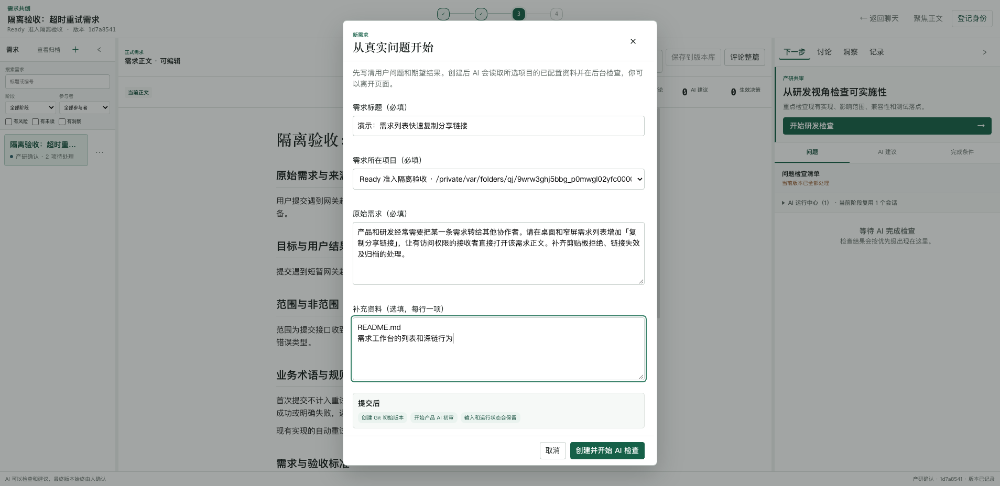
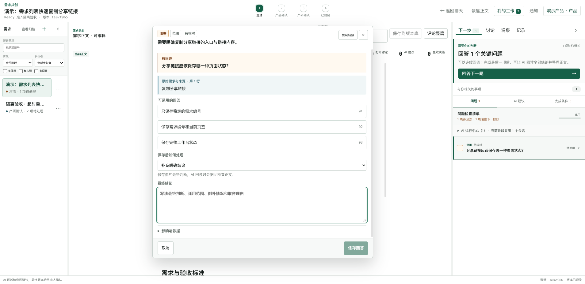
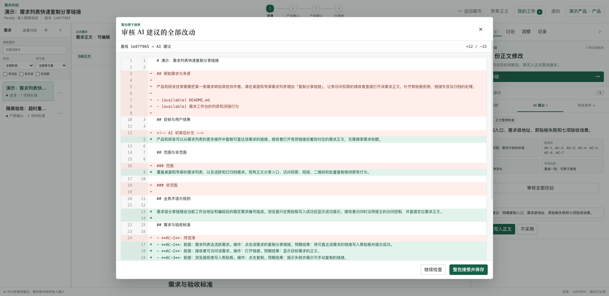
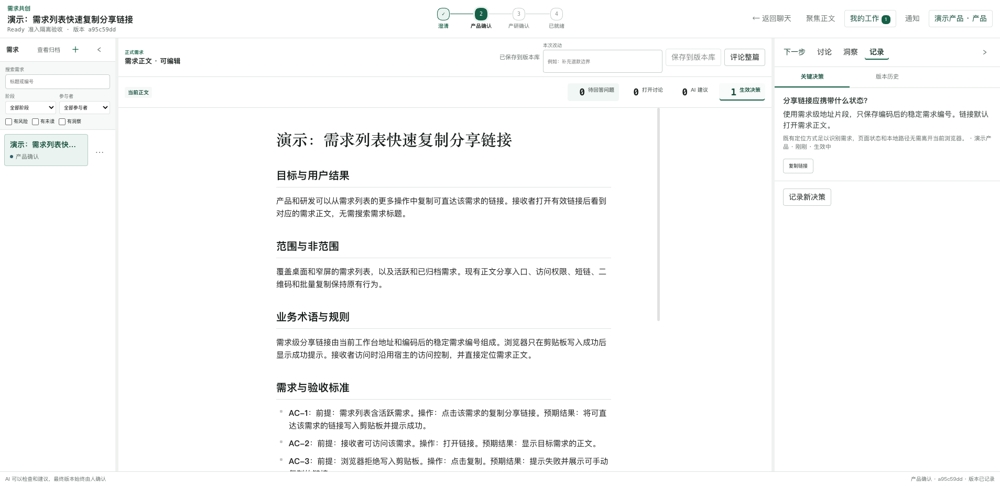
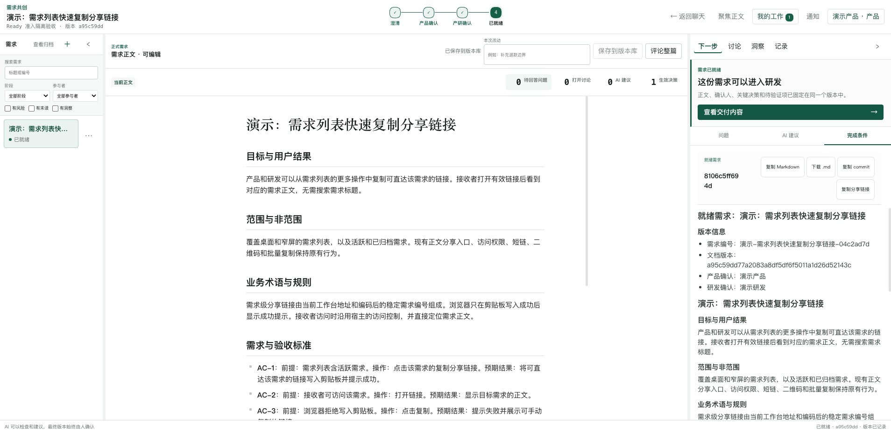

# 完整使用演示：从新需求到 Ready Spec

本页记录 2026-11-25 在 DSH `0.2.2-rc.5` Web 中完成的隔离验收。演示需求为「演示：需求列表快速复制分享链接」。截图来自运行中的 `dsh-spec-collab 0.5.0` 工作台。验收使用可控模型端点返回演示内容，由 DSH 执行会话和工具调用，配合浏览器和 HTTP 操作推进演示流程。

## 演示需求

目标是在桌面端与窄屏需求列表中增加“复制分享链接”：接收者打开链接后直接看到目标需求；复制失败、需求不存在和访问被拒绝时给出明确反馈。需求同时约束地址结构、隐私字段、归档需求、键盘操作与读屏播报，不扩展现有访问权限，也不涉及短链、二维码或批量复制。

## 1. 从空白表单新建需求

从 DSH 侧栏打开「需求讨论」，在需求栏中点击「新建需求」。填写标题、原始需求和可选的补充资料，并选择工作区。首次写入前先登记花名和角色。创建后，原始输入形成首个 Git commit，工作台自动发起产品初审。审核会话使用所选工作区。

## 2. AI 初审，产品逐项澄清

在「下一步」中打开阻塞问题。演示的问题是分享链接应保存哪一种页面状态。选择「只保存稳定的需求编号」，补充结论后点击「保存回答」。回答完成后，点击「让 AI 回读并生成修改」发起二次审核。

回答时应区分事实、推断、假设和待核验内容。当前无法从工作区证明的实现细节保留为 `TO_VERIFY`，不把推测包装为已经确认的事实。

## 3. 审核并接受候选 Patch

AI 根据产品回答生成候选 Patch，人工在写入前检查完整正文、受影响章节和验收标准。本次候选内容补齐了目标与非范围、地址片段规则、剪贴板失败兜底、无效或无权链接语义、七条场景化 AC 及测试约束。

候选 Patch 绑定精确 `baseCommit`。在差异窗口点击「整包接受并保存」会生成新的 Git commit。工作台会发起变更审核。如果仍在澄清阶段，按「下一步」完成新版本要求的产品审核，再进入产品确认。正文改版后，旧 Ready 包、整版确认和待处理候选 Patch 会自动失效。

## 4. 产品确认并记录 Decision

产品检查当前版本后确认 commit，并把关键取舍记录为独立 Decision。本次生效决策为：使用需求级地址片段，只包含编码后的稳定需求 ID，默认打开需求正文；不保存页签、滚动位置或侧栏状态。理由是该方案与工作台已有深链模型一致，同时避免把协作内容或本地路径写入链接。

Decision 与普通评论分离，保留结论、理由、确认人和生效状态，供后续研发检查与 Ready 输出追溯。

## 5. 研发检查与 Ready 质量门

进入产研确认后，点击「开始研发检查」，重点核对现有实现、影响范围、兼容性和测试落点。生成 Ready 前，当前 commit 必须有已完成的研发预审，产品与研发都要完成整版确认，当前版本的审核和候选 Patch 均已处理，且六项内容检查全部通过。

点击「生成就绪需求」，确认后选择「查看交付内容」。本次 Ready Spec 绑定 commit `a95c59dd77a2083a8df5df6f5011a1d26d52143c`，确认人为「演示产品」和「演示研发」。点击「下载 .md」可取得对应的 Ready Markdown，其中包含版本、稳定 AC、生效 Decision、来源、非阻塞待确认问题和双方整版确认人。

## 使用原则

1. 每条需求从新建开始绑定真实项目工作区，不在不同项目上下文之间复用审核结论。
2. AI 负责检查、追问和提出 Patch；写入 Git、确认版本和判定 Ready 始终由人完成。
3. 事实必须带可访问且版本固定的证据；证据不足时明确保留 `TO_VERIFY`。
4. 接受 Patch 前检查 `baseCommit` 和变更范围；正文变化后重新完成受影响的审核与确认。
5. 产品与研发确认同一个 commit，六项质量门全部通过后再输出 Ready Spec。
